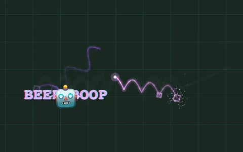
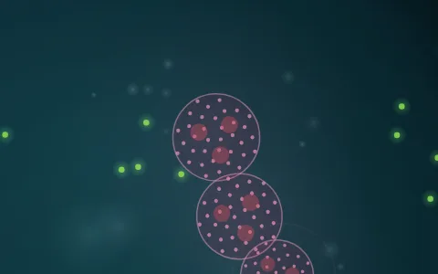
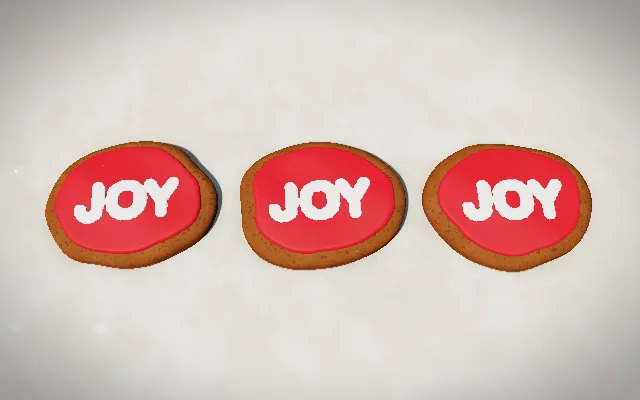

# KEYMASH_

> every keystroke compiles.

KEYMASH is a live-coding language with one rule: **there are no syntax errors.**
Any text is a valid program — a dog walking over the keyboard, a six-year-old
typing their name, a poem, a shopping list, `HACK THE PLANET!!!`. The
interpreter turns all of it into lines, curves, particles, glitches, music and
speech.

**▶ Play it: [mutaphysis.github.io/KEYMASH_](https://mutaphysis.github.io/KEYMASH_/)** — the latest build of `main`.

## Running

TypeScript (strict) + Vite, with bun as package manager and test runner.

```sh
bun install
bun run dev           # Vite dev server with hot reload; TypeScript, oxlint and oxfmt problems show in the terminal and an in-page overlay (closed until you click its badge)
bun run build         # tsc typecheck + vite build -> dist/ (index.html, a main chunk, one chunk per shipped mode)
bun run preview       # serve the production build (it needs http, opening dist/index.html from disk won't work)
bun test              # fuzz + unit tests for the interpreter and the culture
bun run lint          # oxlint
bun run format        # oxfmt (format:check in CI)
bun run analyze       # build, then open the bundle analyzer (DevTools for Rolldown) on :9999
bun scripts/sheet.ts  # re-render the cheat-sheet pictures (see "Cheat-sheet pictures")
bun scripts/icons.ts  # re-render the app icons from scripts/icon.svg
bun scripts/perf.ts   # MYCELIUM_ performance report on the real GPU (--help for options)
```

The scripts drive headless Chromium through playwright-core; the first run needs
`bunx playwright-core install chromium-headless-shell`.

`bun scripts/perf.ts` measures MYCELIUM_'s renderer per text and camera view (home, wide, close,
canopy, crowns, soil): frame time with frames sent back to back, what each group of draws costs
(left out in turn; draws are grouped by fragment shader, buried.frag by pass), fragments shaded
per group (every fragment shader swapped for a counting one: overdraw, heat maps) and so the cost
per fragment, and what overriding uniforms saves (`--set "uHaze=0"`). GPU timer
queries are taken too, but on Apple GPUs each query splits the render pass and inflates the
numbers; the report says so and falls back to the ablation. Results go to `scripts/perf/out/<label>/`
(report.md, result.json, pictures); `--label before` … `--compare before` shows what a change did.

Git hooks ([lefthook](https://lefthook.dev), installed by `bun install`): every commit
formats the staged files with oxfmt (and re-stages them) and lints them with oxlint;
every push runs the tests. `LEFTHOOK=0` skips them once.

The build is what GitHub Pages serves: a small `index.html` and main chunk with the shell,
and every mode as a chunk of its own, fetched when the mode is first used (the one you start
in right away). Cheat-sheet pictures load when the sheet opens. A build ships only the modes listed
in `BUILD_MODES` (`vite.config.ts`, now KEYMASH_ and PETRI_); the others' code and assets stay out of
`dist/`, and links or saved state pointing at them open the first mode. `bun run dev` has every mode.

It is an installable web app (`public/manifest.webmanifest`) with the fonts baked in (no
external requests at all) and it respects the system's "reduce motion" setting: on iOS use Share → Add to
Home Screen, on Android/desktop Chrome the install button. The icon (a paw whose toes
are the A S D F keycaps) lives in `scripts/icon.svg`; `bun scripts/icons.ts` re-renders the PNGs.

The header shows the build: `v<package version> · #<CI run> · <commit>` (local builds
omit the run number, the dev server shows `dev`). Bump the version with
`npm version minor --no-git-tag-version` (or edit `package.json`).

Every push to `main` runs the tests, builds the page and deploys it to GitHub
Pages (`.github/workflows/pages.yml`).

## The modes

**Tap the icon in the header** (or the logo) for the next mode, or pick one in LOAD → MODE.
Each mode keeps its own draft and its own saves. **The book** next to the sound button opens the
mode's cheat sheet; tap a card to add its snippet as a new line. The full language reference
lives with each mode:

<table>
<tr>
<td width="33%"><a href="src/modes/keymash/README.md"></a></td>
<td width="33%"><a href="src/modes/petri/README.md"></a></td>
<td width="33%"><a href="src/modes/cookie/README.md"></a></td>
</tr>
<tr>
<td><b><a href="src/modes/keymash/README.md">KEYMASH_</a></b> — loud and fast. Every line is a thread;
where a key sits decides where it draws and how it sounds; mashes cast spells.</td>
<td><b><a href="src/modes/petri/README.md">PETRI_</a></b> — a quiet culture of cells under a dark-field
microscope. Every line is a genome and a feeder.</td>
<td><b><a href="src/modes/cookie/README.md">COOKIE_</a></b> — warm and edible. The whole text is one recipe:
RUN rolls, cuts, bakes and decorates it in 3D, then every tap is a bite.</td>
</tr>
</table>

<b><a href="src/modes/mycelium/README.md">MYCELIUM_</a></b> (under construction) — the forest floor from the side,
drawn from photographs: the text shapes the ground and its soil horizons; drag to look around, pinch to zoom.

### Links
`?mode=<id>&code=<text>` opens a mode with that text with only the stage showing, waiting for one
tap on RUN (the close button or Esc brings the editor back), e.g.
[`?mode=cookie&code=round%20!!!%20blue%201`](https://mutaphysis.github.io/KEYMASH_/?mode=cookie&code=round%20!!!%20blue%201).
Mode ids: `keymash`, `petri`, `cookie`, `mycelium`; `code` is URL-encoded. Without `code` the link only picks
the mode. It does not start by itself: browsers allow sound and real fullscreen only after a tap,
so RUN starts both.
The text becomes the mode's draft, like a picked demo; the parameters leave the address bar.
SHARE (the link icon) on the play view, between sound and restart, shares such a link to the current mode with the text
as it is now: the system share sheet where there is one, else the link is copied to the clipboard.

### Side by side & live coding
On wide screens (iPad landscape, desktop) editor and stage sit side by side.
While a program runs, every edit is hot-swapped into it ~0.6 s after you stop
typing — the clock, the picture and the sound keep going.

### Fullscreen
**The fullscreen button** in the stage's top right corner hides everything but the picture and, where the
browser allows it, goes fullscreen as well (on iPhone, which has no fullscreen for pages,
only the rest of the UI hides). The same button again or Esc brings the UI back.

### Cheat-sheet pictures
The cards behind the book are listed in `src/modes/<id>/sheet.ts` (snippet, short name, how long it runs
before the picture is taken). `bun scripts/sheet.ts` plays every snippet through the real
interpreter and renderer in headless Chromium, in simulated time with seeded randomness, and
saves the last frame as `src/modes/<id>/sheet/<card>.webp`; it also rewrites the picture
table in the mode's README. The pictures are committed and served as files (about 370 kB of
WebP for the three modes), loaded when the sheet opens. Twelve cards per mode: the sheet shows them in
2, 3, 4 or 6 columns depending on the width, so every row is full.

## Architecture

```
src/main.ts              app shell: layout (phone / split view), run / edit, live hot-swap, drawer, mode switching
src/modes/types.ts       ModeDef (what the shell needs up front) + ModeCode (the rest, loaded on first use)
src/modes/index.ts       the registry: MODES in header-cycle order
src/modes/keymash/       KEYMASH_: interpreter (vm.ts), event protocol (types.ts), emoji powers, player, renderer,
                         backdrop, demos, cheat sheet, messages, theme, README (the language)
src/modes/petri/         PETRI_: genome, sim, culture, renderer, ambient, player, backdrop, demos, cheat sheet, messages, theme, README
src/modes/cookie/        COOKIE_: recipe, shapes (distance fields), bakery (timeline, bites, crumbs), WebGL2 renderer + shaders,
                         music, player, backdrop, demos, cheat sheet, messages, theme, README
src/modes/mycelium/      MYCELIUM_: ground (read from the text), asset preloader + the forest library (assets/),
                         WebGL2 renderer, shaders/ (one file per piece), player, backdrop, demos, messages, theme, README
src/lang/lexer.ts        shared by every mode: total tokenizer (graphemes -> tokens), math evaluator
src/lang/keys.ts         shared: QWERTZ geometry (position, pitch, adjacency)
src/lang/rng.ts          shared: seeded hash + PRNG
src/engine/sound.ts      what the audio engine plays (notes, drums, sfx, phone tones): the modes' sound vocabulary
src/engine/audio.ts      WebAudio synth, drums, sfx, reverb/delay, typing sounds, speech
src/ui/editor.ts         textarea, the mode's backdrop canvases, key bar
src/ui/icon.ts           UI icons: SVGs in src/ui/icons/ (MingCute via Iconify, fetched by scripts/ui-icons.ts), drawn as a CSS mask
src/ui/components/       light-DOM custom elements: km-button, km-mute, km-mode-icon, km-item, km-select, km-toast, km-drawer, km-card
src/ui/storage.ts        per-mode draft and save slots in localStorage; readJson / writeJson for a mode's own data
src/ui/budget.ts         pixel budget: a renderer on a slow device steps down to fewer pixels (every mode)
src/ui/follow.ts         keeps the code view on what is being read, without chasing parallel lines back and forth
src/ui/share.ts          a link to the current mode and text: system share sheet, else the clipboard
src/styles/theme.css.ts  the theme contract (design tokens every mode fills in)
src/styles/global.css.ts the app shell's styles
src/i18n.ts              language detection + defineMessages(); the shared UI's text
scripts/sheet.ts         renders the cheat-sheet pictures (browser side: scripts/sheet/)
scripts/perf.ts          MYCELIUM_'s GPU perf harness (browser side: scripts/perf/, GL instrumentation scripts/perf/gltrace.ts)
scripts/icons.ts         renders the app icons
scripts/ui-icons.ts      downloads the UI icons from the Iconify API and writes src/ui/icons/index.ts
```

Shared code (`src/lang/`, `src/engine/`, `src/ui/`, `src/main.ts`) never imports from a mode;
a mode only builds on it. Every mode reads its text through the same lexer, so the same text
splits into the same tokens, glyph counts and highlight ranges everywhere; what a token *means*
is the mode's business.

The KEYMASH_ VM is pure (no DOM): `vm.tick()` returns a list of timed `VMEvent`s that the
audio engine schedules and the renderer replays at the right moment. Adding an
effect means adding a variant to `VMEvent` (`src/modes/keymash/types.ts`) — the compiler then
points at every place that has to handle it. A new kind of sound goes into `src/engine/sound.ts`.

**Styles** are TypeScript, compiled to plain CSS at build time by
[vanilla-extract](https://vanilla-extract.style). `src/styles/theme.css.ts` is a
theme contract (colours as RGB triplets for `rgba(${vars.rgb.fg}, .45)`, glows,
corner radii); each mode's `theme.css.ts` fills it with `createTheme`, and `tsc`
fails when a token is missing. The theme class sits on `<html>`. What a token
can't express (no scanlines, a breathing icon) goes in the same file as
`` globalStyle(`${theme} …`) ``. Components keep their styles next to them.

**Components** are light-DOM custom elements (no shadow root, so the theme
variables and classes reach them): `<km-button icon="play" label="run" variant="control" primary>`
takes an icon name and message ids for `label` / `title-key`; rows and selects are built with
`KmItem.create()` / `KmSelect.create()`, cheat-sheet cards with `KmCard.create()`.

**Icons** in buttons, rows, selects and toasts come from one set, [MingCute](https://www.mingcute.com)
(filled, rounded, one colour), never emoji. Each is an SVG file in `src/ui/icons/`, imported with
`?url` and drawn as a CSS `mask-image` over `currentColor`, so it takes the text's colour and size
(`iconEl('paw')`, `setIcon(el, 'paw')` from `src/ui/icon.ts`). To add one, put a line into `ICONS`
in `scripts/ui-icons.ts` and run `bun scripts/ui-icons.ts`: it downloads every icon from the
[Iconify API](https://iconify.design/docs/api/) and rewrites `src/ui/icons/index.ts` (the `IconName` type, and
`INK`: the rows each icon's drawing covers, measured in headless Chromium, so `iconFillClip()` fills a gauge
icon over its drawing rather than its box).
Emoji stay where they are program text: demos, the key bar's emoji keys, what a program shows.

**Text**: every part defines its own messages with `defineMessages(en, de)` — the
shared UI in `src/i18n.ts`, each mode in `src/modes/<id>/messages.ts`. `en` is the
reference; `tsc` fails if `de` is missing an id or has a different shape (string,
`{ one, other }` plural, or a list to pick from). The language comes from the
drawer setting or, on auto, the system (German if preferred, else English).
Markup is translated through `data-i18n` (text) and `data-i18n-title` /
`-aria-label` / `-placeholder`. Program keywords (`dog`, `hack`, …) stay the same
in every language.

### Adding a mode

1. Make `src/modes/<id>/` with
   - `index.ts` exporting a small `ModeDef` (`src/modes/types.ts` documents every field):
     name, emoji, header icon (inline SVG), tagline, theme, transition, and
     `load: () => import('./mode').then((m) => m.mode)`. It goes into the main bundle, so keep
     it free of anything heavy.
   - `mode.ts` exporting `mode: ModeCode`: demos, key bar symbols, typing sound, status line,
     a `Backdrop` for the editor and a `ModePlayer` for the stage (`#stage`, `#hud`, `#log`,
     `#boot`, `#codeview`). This and everything it imports become the mode's own chunk.

   Read the text with `lex()` (`src/lang/lexer.ts`), place keys with `keyInfo()`, seed with
   `hash()` / `mulberry32()`, play `Sound`s through the shared `AudioEngine`; everything else
   (the interpreter, its events, its effects) lives in the mode's folder.
2. `messages.ts`: `defineMessages(en, de)` for its text.
3. `theme.css.ts`: `createTheme(vars, {...})` plus a `style()` with the animation
   for switching in and starting / stopping (`transition`).
4. `sheet.ts`: the cheat-sheet cards (`SHEET`), and a capture function for the mode in
   `scripts/sheet/shoot.ts`; then `bun scripts/sheet.ts`. `README.md` documents the mode's
   language, with the `sheet:start` / `sheet:end` markers for the picture table.
5. Optional: `drawer(ctx)` in `ModeCode` returns extra drawer sections (KEYMASH_ adds VOICE);
   `view` (`ModeView`: icon, title, `open(ctx)`, optional `reopen()`) puts a button into the header
   that opens a second view over the whole app (PETRI_'s lab). The shell stops a running program
   first and hides the editor and stage (`#app.viewing`) until the view calls `ctx.close()`. When
   `reopen()` says it was open as the page was left, the shell opens it again at start.
6. Add it to `MODES` in `src/modes/index.ts`. The header icon, the mode select,
   storage (`keymash.slots.<id>.v1`, `keymash.draft.<id>.v1`) and the theme switch pick it up.

## License

CC0 1.0 Universal — public domain. Mash freely.
