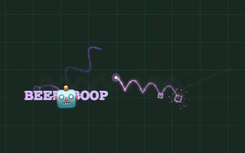
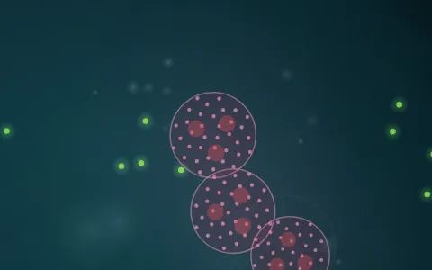

# KEYMASH_

> every keystroke compiles.

KEYMASH is a live-coding language with one rule: **there are no syntax errors.**
Any text is a valid program — a dog walking over the keyboard, a six-year-old
typing their name, a poem, a shopping list, `HACK THE PLANET!!!`. The
interpreter turns all of it into lines, curves, particles, glitches, music and
speech.

## Running

TypeScript (strict) + Vite, with bun as package manager and test runner.

```sh
bun install
bun run dev           # Vite dev server with hot reload; TypeScript, oxlint and oxfmt problems show in the terminal and an in-page overlay
bun run build         # tsc typecheck + vite build -> dist/index.html (one self-contained file)
bun run preview       # serve the production build
bun test              # fuzz + unit tests for the interpreter and the culture
bun run lint          # oxlint
bun run format        # oxfmt (format:check in CI)
bun run analyze       # build, then open the bundle analyzer (DevTools for Rolldown) on :9999
bun scripts/sheet.ts  # re-render the cheat-sheet pictures (see "Cheat-sheet pictures")
bun scripts/icons.ts  # re-render the app icons from scripts/icon.svg
```

Both scripts drive headless Chromium through playwright-core; the first run needs
`bunx playwright-core install chromium-headless-shell`.

Git hooks ([lefthook](https://lefthook.dev), installed by `bun install`): every commit
formats the staged files with oxfmt (and re-stages them) and lints them with oxlint;
every push runs the tests. `LEFTHOOK=0` skips them once.

The build is a single HTML file with everything inlined (vite-plugin-singlefile),
so it also works opened straight from disk or as a Claude artifact.

It is an installable web app (`public/manifest.webmanifest`) with the fonts baked in (no
external requests at all) and it respects the system's "reduce motion" setting: on iOS use Share → Add to
Home Screen, on Android/desktop Chrome the install button. The icon (a paw whose toes
are the A S D F keycaps) lives in `scripts/icon.svg`; `bun scripts/icons.ts` re-renders the PNGs.

The header shows the build: `v<package version> · #<CI run> · <commit>` (local builds
omit the run number, the dev server shows `dev`). Bump the version with
`npm version minor --no-git-tag-version` (or edit `package.json`).

Every push to `main` runs the tests, builds the page and deploys it to GitHub
Pages (`.github/workflows/pages.yml`).

## The modes

**Tap the icon in the header** (or the logo) for the next mode, or pick one in 📂 LOAD → MODE.
Each mode keeps its own draft and its own saves. **📖** next to the sound button opens the
mode's cheat sheet; tap a card to add its snippet as a new line. The full language reference
lives with each mode:

<table>
<tr>
<td width="50%"><a href="src/modes/keymash/README.md"></a></td>
<td width="50%"><a href="src/modes/petri/README.md"></a></td>
</tr>
<tr>
<td><b><a href="src/modes/keymash/README.md">KEYMASH_</a></b> — loud and fast. Every line is a thread;
where a key sits decides where it draws and how it sounds; mashes cast spells.</td>
<td><b><a href="src/modes/petri/README.md">PETRI_</a></b> — a quiet culture of cells under a dark-field
microscope. Every line is a genome and a feeder.</td>
</tr>
</table>

### Side by side & live coding
On wide screens (iPad landscape, desktop) editor and stage sit side by side.
While a program runs, every edit is hot-swapped into it ~0.6 s after you stop
typing — the clock, the picture and the sound keep going.

### Fullscreen
**⛶** in the stage's top right corner hides everything but the picture and, where the
browser allows it, goes fullscreen as well (on iPhone, which has no fullscreen for pages,
only the rest of the UI hides). ✖ or Esc brings the UI back.

### Cheat-sheet pictures
The cards behind 📖 are listed in `src/modes/<id>/sheet.ts` (snippet, short name, how long it runs
before the picture is taken). `bun scripts/sheet.ts` plays every snippet through the real
interpreter and renderer in headless Chromium, in simulated time with seeded randomness, and
saves the last frame as `src/modes/<id>/sheet/<card>.webp`; it also rewrites the picture
table in the mode's README. The pictures are committed and inlined into the build
(about 165 kB of WebP, ~220 kB as base64). Twelve cards per mode: the sheet shows them in
2, 3, 4 or 6 columns depending on the width, so every row is full.

## Architecture

```
src/main.ts              app shell: layout (phone / split view), run / edit, live hot-swap, drawer, mode switching
src/modes/types.ts       ModeDef: everything a mode brings (see "Adding a mode")
src/modes/index.ts       the registry: MODES in header-cycle order
src/modes/keymash/       KEYMASH_: mode definition, player, renderer, backdrop, demos, cheat sheet, messages, theme, README (the language)
src/modes/petri/         PETRI_: genome, sim, culture, renderer, ambient, player, backdrop, demos, cheat sheet, messages, theme, README
src/lang/types.ts        the event protocol (discriminated union) + op / sound / shape kinds
src/lang/lexer.ts        total tokenizer (graphemes -> tokens), math evaluator
src/lang/keys.ts         QWERTZ geometry (position, pitch, adjacency), emoji powers
src/lang/rng.ts          seeded hash + PRNG shared by every mode
src/lang/vm.ts           the KEYMASH interpreter: threads, loops, forks, emits events
src/engine/audio.ts      WebAudio synth, drums, sfx, reverb/delay, typing sounds, speech
src/ui/editor.ts         textarea, the mode's backdrop canvases, key bar
src/ui/components/       light-DOM custom elements: km-button, km-mute, km-mode-icon, km-item, km-select, km-toast, km-drawer, km-card
src/ui/storage.ts        per-mode draft and save slots in localStorage
src/styles/theme.css.ts  the theme contract (design tokens every mode fills in)
src/styles/global.css.ts the app shell's styles
src/i18n.ts              language detection + defineMessages(); the shared UI's text
scripts/sheet.ts         renders the cheat-sheet pictures (browser side: scripts/sheet/)
scripts/icons.ts         renders the app icons
```

The VM is pure (no DOM): `vm.tick()` returns a list of timed `VMEvent`s that the
audio engine schedules and the renderer replays at the right moment. Adding an
effect means adding a variant to `VMEvent` — the compiler then points at every
place that has to handle it.

**Styles** are TypeScript, compiled to plain CSS at build time by
[vanilla-extract](https://vanilla-extract.style). `src/styles/theme.css.ts` is a
theme contract (colours as RGB triplets for `rgba(${vars.rgb.fg}, .45)`, glows,
corner radii); each mode's `theme.css.ts` fills it with `createTheme`, and `tsc`
fails when a token is missing. The theme class sits on `<html>`. What a token
can't express (no scanlines, a breathing icon) goes in the same file as
`` globalStyle(`${theme} …`) ``. Components keep their styles next to them.

**Components** are light-DOM custom elements (no shadow root, so the theme
variables and classes reach them): `<km-button icon="▶" label="run" variant="control" primary>`
takes message ids for `label` / `title-key`; rows and selects are built with
`KmItem.create()` / `KmSelect.create()`, cheat-sheet cards with `KmCard.create()`.

**Text**: every part defines its own messages with `defineMessages(en, de)` — the
shared UI in `src/i18n.ts`, each mode in `src/modes/<id>/messages.ts`. `en` is the
reference; `tsc` fails if `de` is missing an id or has a different shape (string,
`{ one, other }` plural, or a list to pick from). The language comes from the
drawer setting or, on auto, the system (German if preferred, else English).
Markup is translated through `data-i18n` (text) and `data-i18n-title` /
`-aria-label` / `-placeholder`. Program keywords (`dog`, `hack`, …) stay the same
in every language.

### Adding a mode

1. Make `src/modes/<id>/` with an `index.ts` exporting a `ModeDef` (`src/modes/types.ts`
   documents every field): name, emoji, header icon (inline SVG), tagline, demos,
   key bar symbols, typing sound, status line, a `Backdrop` for the editor and a
   `ModePlayer` for the stage (`#stage`, `#hud`, `#log`, `#boot`, `#codeview`).
2. `messages.ts`: `defineMessages(en, de)` for its text.
3. `theme.css.ts`: `createTheme(vars, {...})` plus a `style()` with the animation
   for switching in and starting / stopping (`transition`).
4. `sheet.ts`: the cheat-sheet cards (`SHEET`), and a capture function for the mode in
   `scripts/sheet/shoot.ts`; then `bun scripts/sheet.ts`. `README.md` documents the mode's
   language, with the `sheet:start` / `sheet:end` markers for the picture table.
5. Optional: `drawer(ctx)` returns extra drawer sections (KEYMASH_ adds VOICE).
6. Add it to `MODES` in `src/modes/index.ts`. The header icon, the mode select,
   storage (`keymash.slots.<id>.v1`, `keymash.draft.<id>.v1`) and the theme switch pick it up.

## License

CC0 1.0 Universal — public domain. Mash freely.
