# COOKIE_ — the language

[← back to the README](../../../README.md) · [← PETRI_](../petri/README.md)

COOKIE_ is the warm one: the whole text is one recipe. RUN drops the dough, rolls it, cuts it,
bakes it and decorates it; then the cookies are yours to eat, one tap a bite.

## Cheat sheet

The 📖 button in the header shows these cards in the app; tap one to add its snippet as a new line. The pictures are real frames of the snippets, rendered by `bun scripts/sheet.ts`.

<!-- sheet:start (bun scripts/sheet.ts writes this table) -->
<table>
<tr>
<td width="33%">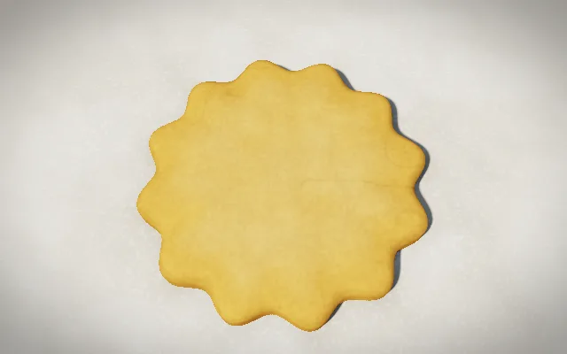 <b>round</b> <code>butter round plain 1</code></td>
<td width="33%">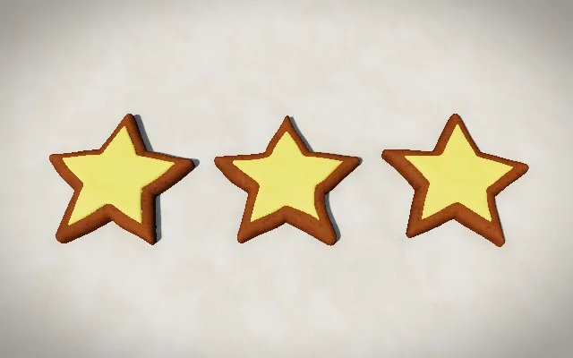 <b>star</b> <code>ginger ⭐ 3</code></td>
<td width="33%">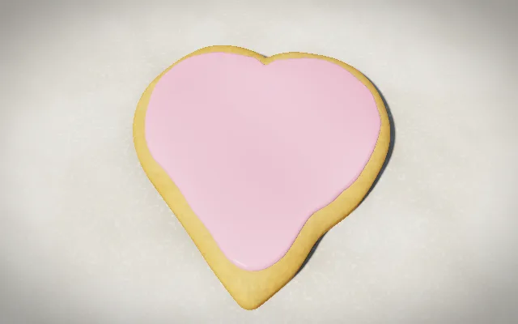 <b>heart</b> <code>❤️ !! pink 1</code></td>
</tr>
<tr>
<td width="33%">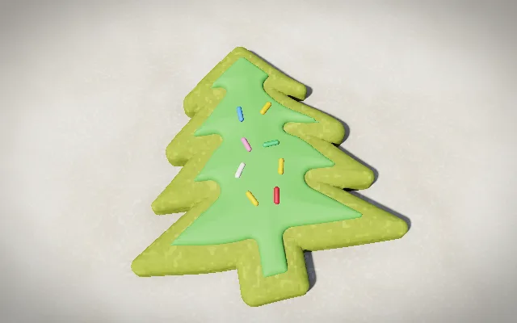 <b>tree</b> <code>🎄 matcha ! green *** 1</code></td>
<td width="33%">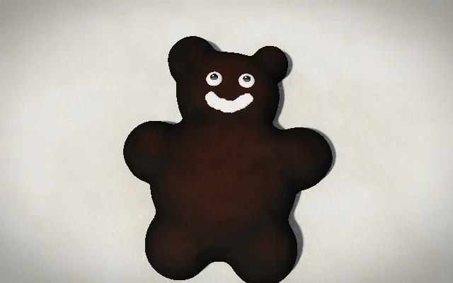 <b>bear</b> <code>🐻 cocoa :) 1</code></td>
<td width="33%">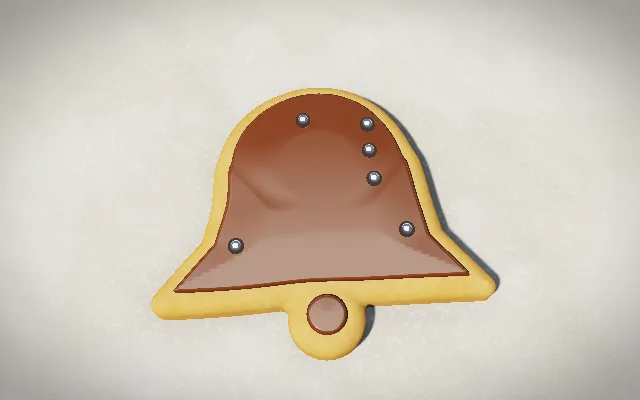 <b>bell</b> <code>🔔 🍫 °°° 1</code></td>
</tr>
<tr>
<td width="33%">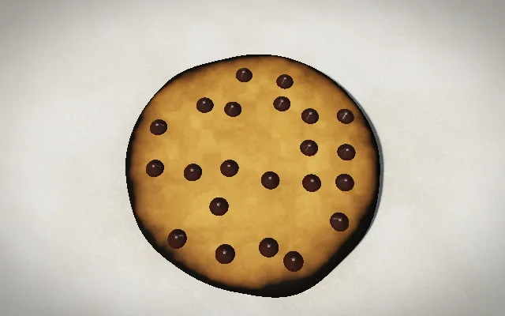 <b>chips</b> <code>oat round plain .... 1</code></td>
<td width="33%">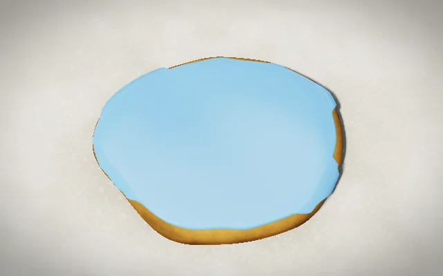 <b>runny icing</b> <code>round !!! blue 1</code></td>
<td width="33%">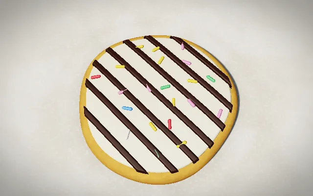 <b>stripes</b> <code>round 🍫 = white 1</code></td>
</tr>
<tr>
<td width="33%">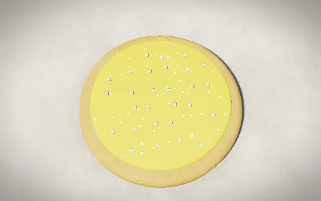 <b>sugar &amp; glitter</b> <code>round ! +++ ✨ 1</code></td>
<td width="33%">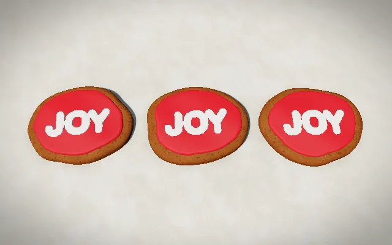 <b>letters</b> <code>[JOY] 3 ! red round</code></td>
<td width="33%">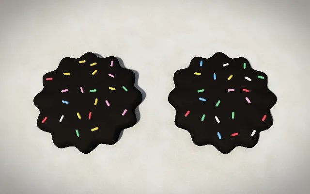 <b>burnt</b> <code>round plain 250 30 2</code></td>
</tr>
</table>
<!-- sheet:end -->

## The recipe

Words, symbols, emoji and numbers can stand anywhere, on any line. Whatever the text leaves
open is decided by the text itself (its hash), so the same text always bakes the same batch
and any keysmash is a recipe.

| | you write | otherwise |
|---|---|---|
| how many | `1` `2` `3`, `one` `two` `three` | 1–3 from the text |
| dough | `butter` `ginger` `cocoa` `oat` `matcha` | from the first word |
| thickness | `thin` `thick` | more CAPITALS, thicker |
| rise | `flat` `puffy` | held keys (`aaa`) puff it up |
| chocolate chips | `.` (three each), `chips` | none |
| cutter | `round` 🍪, `star` ⭐, `heart` ❤️, `tree` 🎄, `bear` 🐻, `bell` 🔔 | from the longest word |
| turned | `/` and `\` (15° each) | a little |
| size | `tiny` `small` `big` `huge` | longer text, bigger cookies |
| oven | a number from 100: degrees; 4–99: minutes; 🔥 ❄️ ±20° | 160–200°, 9–14 min |
| coating | `icing` 🥛 or any `!`, `chocolate` 🍫, `glaze` 🍯, `plain` | from the text |
| how it flows | `!` thick, `!!` smooth, `!!!` runny; `matte` `glossy` `runny` | from the text |
| colour | `white red pink orange yellow green mint blue purple`, 🍓 🍋 🍊 🥝 🫐 🍇; the second colour named pipes the pattern | from the text |
| pattern | `=` stripes, `~` zigzag, `@` swirl, `%` half dipped, `#` border | plain |
| toppings | `*` sprinkles, `+` sugar, `-` chocolate strands, `°` pearls; more symbols, more of it | sometimes a few sprinkles |
| glitter | `^` ✨ | none |
| face | `:` 👀 eyes, `)` smile, `(` frown | none |
| letters | `[JOY]`: up to three, piped on | none |
| on top | 🍒 `cherry`, 🥜 `almond` | nothing |
| message | `"in quotes"` | Season's Greetings |

Hot and long burns: `250 30` comes out black. At most two toppings; a face or letters thin
them out so the cookie never gets crowded. Chocolate takes `white` (white chocolate) and
`pink` (ruby); every other colour makes it milk chocolate. An uncoated cookie gets its pattern
piped straight on.

## The sequence

The dough ball drops and is rolled out in three passes, the cutters come down, the scrap goes,
chips land, the oven glows while the timer runs (the HUD shows it), the cookies rise and brown,
then coating, pattern, toppings and the finishing touches, each only if the recipe has them.
The code view lights up the words that decide the stage at work. At the end the message appears
under the cookies: big round letters in the cookie's colours, hopping a little.

The cookies of a batch differ a little in outline and turn. With `prefers-reduced-motion` the
camera stands still, the dough does not bounce and the oven air does not shimmer.

Editing while it runs (split view): a changed recipe sweeps the tray and bakes again, about
2.5× faster.

## Eating

Tap a cookie to bite a piece off. Crumbs fall, bounce and stay, on the cookie or on the tray.
A cookie that is almost gone crumbles. When the tray is empty a new batch starts.

## Sound

A small seeded music box (key and tempo from the text) follows the stages: plucks and bass while
the dough is worked, a pad while the oven hums, bells for the decoration, a piano joins when it
is served. Every thud, cut, chip, oven tick, sprinkle, bite and crumb has its own sound.

## How it is drawn

One raymarched distance field in hand-written WebGL2 (`render.ts`, `shader.ts`): soft shadows,
ambient occlusion and procedural materials, no textures. Each cookie's outline, its bites and
its piped letters live in a small distance texture (`shapes.ts`, `Field`). The scene renders
into a smaller target that steps down by itself when frames take too long.
