# KEYMASH_ — the language

[← back to the README](../../../README.md) · [PETRI_ →](../petri/README.md)

Keysmash doesn't produce real words, so KEYMASH never looks words up. It reads
*how* the keys were hit: where they sit on the keyboard, how they cluster,
repeat and roll.

## Cheat sheet

The 📖 button in the header shows these cards in the app; tap one to add its snippet as a new line. The pictures are real frames of the snippets, rendered by `bun scripts/sheet.ts`.

<!-- sheet:start (bun scripts/sheet.ts writes this table) -->
<table>
<tr>
<td width="33%">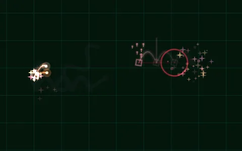<br><b>roll</b> <code>asdf poiu</code></td>
<td width="33%">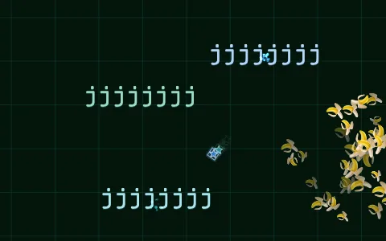<br><b>held key</b> <code>jjjjjjjj</code></td>
<td width="33%">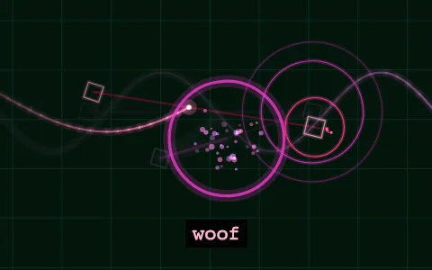<br><b>CAPS speak</b> <code>WOOF WOOF!</code></td>
</tr>
<tr>
<td width="33%">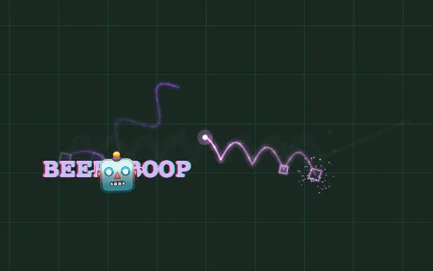<br><b>spell</b> <code>lkjhgfdsa</code></td>
<td width="33%">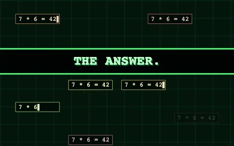<br><b>math</b> <code>7*6=</code></td>
<td width="33%">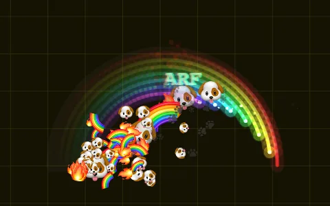<br><b>emoji</b> <code>🐶🔥🌈</code></td>
</tr>
<tr>
<td width="33%">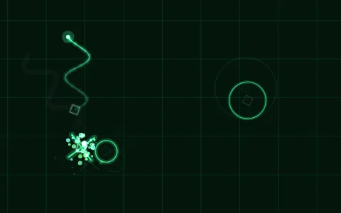<br><b>letters</b> <code>c o s x</code></td>
<td width="33%">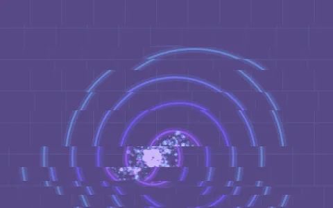<br><b>boom</b> <code>!!!</code></td>
<td width="33%">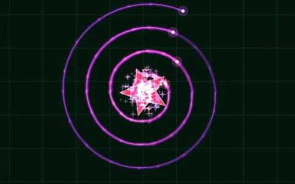<br><b>spiral + stars</b> <code>@@ ***</code></td>
</tr>
<tr>
<td width="33%">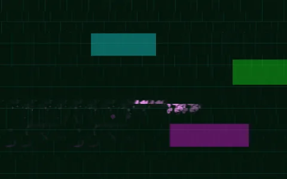<br><b>glitch</b> <code>asdf ###</code></td>
<td width="33%">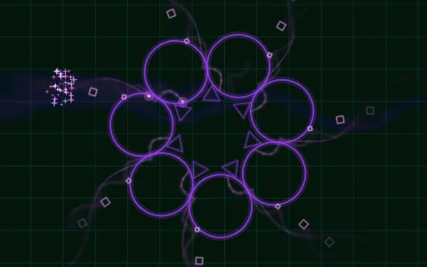<br><b>kaleidoscope</b> <code>qwertz %</code></td>
<td width="33%">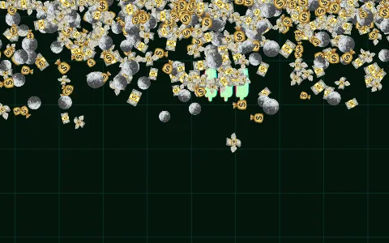<br><b>money rain</b> <code>$$$$</code></td>
</tr>
</table>
<!-- sheet:end -->

## Threads
Every non-empty **line** is a thread. All threads run **in parallel**, in sync
with a global clock (16th notes, 120 BPM). When a thread reaches the end of its
line it loops, and every loop (a *generation*) mutates: colours shift, the
keyboard map rotates, the harmony moves on (i – IV – III – VII).

## Key geometry (German QWERTZ)
Each letter is placed by **where its key sits**:

- **position** – the key's spot on the keyboard is its spot on screen. A key-cap
  lights up there and the paw's path between keys is drawn as a glowing line.
  Every thread gets its own rotated copy of the keyboard.
- **pitch** – column = scale step (left low, right high), row = octave
  (`qwertz…` high, `asdf…` middle, `yxcv…` low). Everything is pentatonic, so
  it always sounds fine.

## Mash patterns
| Pattern | Example | Effect |
|---|---|---|
| held key | `jjjjjjj` | ratchet: the sound repeats as a roll, stream of particles, shake when long |
| roll over neighbours | `asdf`, `poiu` | glissando + an arcing sweep through the keys |
| CAPS chunk | `WOOF`, `ASDKJ` | spoken out loud — by the system voice, or by the built-in *babble* voice (pick in 📂 LOAD → VOICE; default on Firefox/macOS, where system speech clicks) |
| chunk + `?`/`!` | `fjdk?` | spoken as a question / exclamation |
| long chunk (≥5) | `lkjhgfdsa` | casts a **spell** from the effect library, picked by the chunk's hash (same mash → same spell). Spells have a cooldown shared by all threads: 1.5 s each, and all hacker spells together at most once every 4 s. While a spell cools down, the chunk just floats away as text. |
| number | `42` | shown on screen, dialled as DTMF phone tones, becomes the argument of the next op |
| math | `7*6=`, `12/0` | evaluated and rendered on screen, spread over the stage without overlapping (max 6 at once); `42` and `∞` have surprises, at most once every 4 s |
| quote | `"hello"` | spoken (unclosed quote: rest of the line) |
| emoji | `🐶🔥🌈` | stamped on screen; many have powers (🐶 runs and barks, 💥 explodes, 🌀 tunnels…) |

## Letters (the dog alphabet)
Besides its position and pitch, every letter has a character:
```
a arc        b bass+pulse   c circle      d kick+zoom    e echo/feedback
f forward    g glitch       h hi-hat      i ping+line    j jump+boing
k snare      l long line    m mirror      n note+dot     o ring
p particles  q quake        r rotate      s sine curve   t triangle
u octave up  v vibrato      w wave        x explode      y yay confetti
z zap+lightning
```
Uppercase is twice as big and loud. Umlauts and other alphabets fold onto keys.

## Symbols
```
!  BOOM            ?  random letter     .  rest          ,  short rest
~  sine glide      -  line              _  floor         |  clap + vertical
/ \ diagonals      *  star burst        #  big glitch    @  spiral
$  money rain      %  kaleidoscope      ^  jump up       +  grow
=  chord           <  turn left         >  turn right    :  repeat last op
&  fork thread     ( ) loop (n( … ) repeats n times)
[ ] spawn a parallel thread for the bracket content
{ } spin the view   ` small glitch       ; snare
```
Unmatched brackets are fine: `)` alone jumps back to the start of the line,
`(` alone simply marks a spot, `[` without `]` spawns the rest of the line.
Runs of a symbol (`!!!`) are stronger.

## Spells (output only)
Shapes (circle, star, heart, flower, fractal tree, snowflake…), curves with their
formula on screen (sin, cos, tan, rose `r = cos(kθ)`, Lissajous knots, random
function plots), particle storms (fire, rain, snow, confetti, fireworks,
bubbles, money), screen tricks (glitch, spin, zoom, flip, mirror, kaleidoscope,
feedback tunnel, warp), instrument and scale changes, hacker banners
(`ACCESS GRANTED`, `DOWNLOADING MORE RAM`…), and creatures: dogs, cats, dinos,
dragons, unicorns, a squirrel that gives every thread the zoomies.

Also: fractals and attractors drawn live with their formula (Sierpiński triangle, Koch
snowflake, dragon curve, Lorenz attractor, spirograph, golden spiral, π, `10 PRINT`),
sky effects (aurora, black hole, constellations with made-up names, meteor shower),
instruments (ECG heartbeat, radar sweep, barcode scanner), set pieces (disco, fanfare,
drum fill, a blue screen) and more creatures (bee, frog, owl, whale, snake).

## Tempo
There is no tempo setting. The text sets it: shouty mashing (CAPS, `!`, held keys) plays
faster, calm text (spaces, dots, `~`) plays slower, between 70 and 120 BPM (never faster). Speed-up and
slow-down spells push it around and it drifts back. Tap the stage four times in a steady
rhythm and the program follows your beat.

## In play mode
Tap the screen to play notes and bursts yourself.

## Typing sounds
In the editor every key plays a soft kalimba note (pitched by its position on
the keyboard), space is a brush, Enter strums a chord, backspace sighs, and a
warm pad breathes in while you type. Fast typing gets quieter, not louder.

