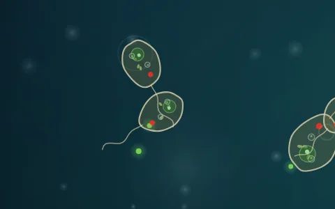
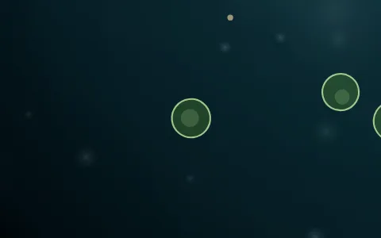
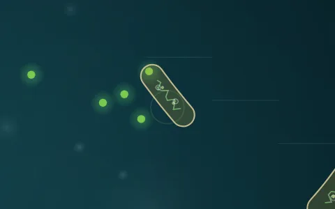
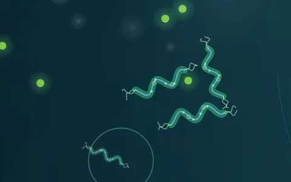
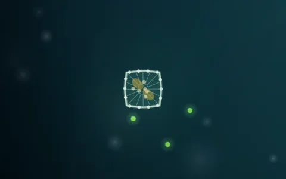
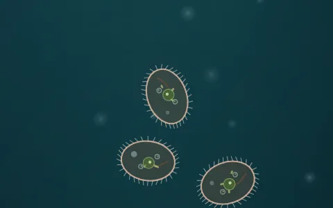
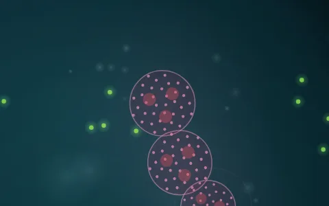
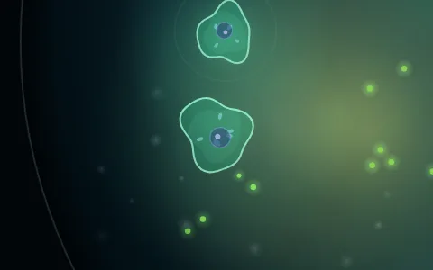
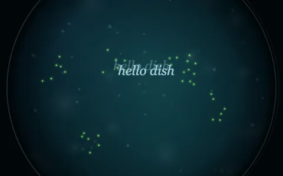
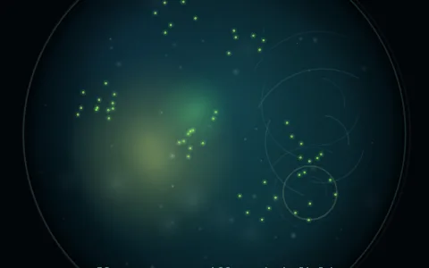

# PETRI_ — the language

[← back to the README](../../../README.md) · [← KEYMASH_](../keymash/README.md) · [COOKIE_ →](../cookie/README.md)

PETRI_ is the quiet one: a culture of cells under a dark-field microscope. Every line of
text is the genome of a species and, read slowly, a feeder for the dish.

## Cheat sheet

The book button in the header shows these cards in the app; tap one to add its snippet as a new line. The pictures are real frames of the snippets, rendered by `bun scripts/sheet.ts`.

<!-- sheet:start (bun scripts/sheet.ts writes this table) -->
<table>
<tr>
<td width="33%"> <b>amoeba</b> <code>asdf jkl</code></td>
<td width="33%"> <b>flagellate</b> <code>qwert zuiop</code></td>
<td width="33%"> <b>coccus</b> <code>yxcv bnm</code></td>
</tr>
<tr>
<td width="33%"> <b>bacillus</b> <code>lang_lang-ein</code></td>
<td width="33%"> <b>spirillum</b> <code>ss@ss</code></td>
<td width="33%"> <b>diatom</b> <code>#%# 42 abc</code></td>
</tr>
<tr>
<td width="33%"> <b>ciliate</b> <code>jjjj kkkk</code></td>
<td width="33%"> <b>volvox</b> <code>ooo (o)</code></td>
<td width="33%"> <b>predator</b> <code>HUNTER</code></td>
</tr>
<tr>
<td width="33%"> <b>photosynthetic</b> <code>asdf* 🌿☀️</code></td>
<td width="33%"> <b>words in the water</b> <code>"hello dish"</code></td>
<td width="33%"> <b>feeding the dish</b> <code>🌿 ☀️ ~ 🫧</code></td>
</tr>
</table>
<!-- sheet:end -->

## Every line is a genome
How a line was typed decides what grows from it:

| In the line | Trait |
|---|---|
| keyboard row the paw stayed on | body: home row → amoeba, top row → flagellate, bottom row → coccus |
| `-` `_` `\|`, long words | rod bacterium (bacillus) |
| `@`, many `s` | spirillum |
| `#` `%`, digits | diatom (glass shell, armoured) |
| held keys `jjjj`, `=` | ciliate |
| `(` `)`, many `o` | volvox (rolling colony) |
| where on the keyboard | colour |
| vowels, word length | size |
| CAPS | predator (lots) or omnivore (some) |
| `*`, 🌿 ☀️ | photosynthetic, glows |
| `!` | toxic: whoever eats it gets sick |
| `&` 💞 | symbiotic: shares food with other symbionts |
| `...` 🍄 | leaves spores when it dies |
| `?` | mutates more when dividing |
| `+` | divides sooner |
| spaces | calmer, slower |

Each trait lands on one of a few steps of its gene: a genome is a sequence of 20 genes
(body, size, lobes, wobble, organelles, flagella, speed, diet, fertility, life span, mutation,
toxin, armour, colony, symbiosis, spores, colour, second colour, saturation, glow), written as
29 bases `A C G T`. New genes only ever go at the end, so an older, shorter sequence still reads:
the missing genes take their default. Every species gets a binomial name made from its genes,
so the same genome is called the same wherever it came from (*Chymella lula*, *Chypomonas
vorax*); the epithet names its most striking trait when it has one (*vorax* a predator, *toxica*,
*armata*, *lucens*, *sporifera*, *socialis*, *gregaria*, *viridis*, *omnivora*). Two lines with the
same genes get a number (*Chymella lula 2*). A species is introduced in the dish when it first
appears.

Every gene shows on every body, so two genomes never look alike:

| Gene | Look |
|---|---|
| size | how big (above 24 units sizes bend toward the largest, 36, so no two steps look the same) |
| lobes | amoeba and flagellate: lobes · bacillus: rod length · coccus: a slight 2–5-fold dent · spirillum: turns · diatom: round, boat, triangle, square · ciliate: width · volvox: daughter colonies |
| wobble | how much the outline moves (a rod bends, a coccus or volvox breathes, a ciliate squishes, the glass diatom rocks) |
| organelles | organelles; bacteria granules, a diatom oil drops, a volvox more cells on its surface |
| flagella | 0–3 whips (a spirillum's tufts at both ends, a diatom's mucus threads, a ciliate's cirri, a volvox's paired flagella on its rim cells) |
| speed | the cell's own movements run faster |
| diet | grazer: food vacuoles · photosynthetic: green chloroplasts (a diatom: golden) · omnivore: both · predator: red digestive vacuoles and a mouth or food cup |
| fertility | buds on the rim |
| life span | a short-lived species is paler |
| mutation | the second colour flickers |
| toxin | little skulls inside |
| armour | a thick wall, then plates, then studs |
| colony | a mucus sheath around it |
| symbiosis | tiny partners riding on the membrane |
| spores | a spore sac |
| colours, saturation, glow | membrane, nucleus (or DNA, cytoplasm, stripes), the halo |

## Every line is also a feeder
The same line is read slowly, one token per beat (0.75 s), all lines in parallel:
words release cells of that species, numbers drop algae, `.` crumbs, `*` light,
`~` `@` a swirling current, `-` `/` a straight current, `!` a nutrient burst,
`#` sediment; emoji: 🌿 a garden that keeps growing, ☀️ light, 💧 current, 🫧
nutrients, 🍄 spores, 🦠 more cells, ❄️ cold, 🔥 warmth, ☠️ toxin, 🍬 sugar, 💞 a call
to the symbionts. Sums (`3*7=`) and `"quotes"` are written into the water.
Tap the dish to drop food.

## Life in the dish
Cells sense food, prey and threats. Rod bacteria run and tumble (keep running while
food gets closer — real chemotaxis), flagellates dart, amoebae crawl, cocci jiggle and
cluster, volvox rolls. Grazers eat algae, photosynthetic cells feed on light,
predators engulf smaller cells of other species (toxic prey makes them sick: they crawl,
lose part of the life they had left and cannot divide until it wears off), symbionts
even out their energy when they touch. Cells divide with small mutations, age and
die; their debris feeds the next generation and spores hatch later. Division is drawn
as it happens: cells with a nucleus go through mitosis (the envelope dissolves,
chromosomes line up on the spindle and are pulled apart, a cleavage furrow pinches the
membrane, two nuclei form), bacteria split by binary fission (the rod doubles, the DNA
separates, a wall grows in from the middle), ciliates split front to back. Dying cells
swell, grey, their membrane breaks up and their contents drift away. Field notes
record the firsts: first division, first engulfing, extinctions. The census in the top left
corner lists every species, the most numerous first, three at a time: it glides slowly down
the list and back up, resting at either end (with reduced motion it steps a row at a time).

## Taking up genes
A meal can change the eater's genome. Engulfing a live cell passes genes on in 40 % of
meals, a piece of the debris a dead cell leaves in 6 % (debris carries its cell's genome
until it is eaten or rots). The eater takes up one to three genes that differ from its own:
graded genes (size, speed, toxin, armour, glow, colony, fertility, life span, mutation rate,
saturation, wobble, organelles, lobes, flagella) and the second colour move a third to half of
the way toward the donor's, at least one step; body plan, diet, spores and symbiosis are taken
over outright. Each may mutate at the eater's mutation rate (`?` in its line). The main colour
moves toward the donor's, too.

The eater becomes a new species right away, a hybrid named the way botanists write them:
its own genus and an epithet spliced from both parents (*Chypomonas × vorula*). Its
daughters inherit the new genome. A hybrid is introduced like any newcomer, gets a field
note (who took up whose genes), a short phrase on the eater's, donor's and its own
instrument, a place in the census while it lives, and can go extinct. Hybrids can take up
genes again. Eating its own kind passes nothing on, and at most 6 hybrid species live at
once; past that, meals are only food. A hybrid belongs to no line: the code does not
inoculate it, and a live edit leaves it alone.

The code has a second way for hybrids to arise, switched off for now: with `SPECIATION =
'drift'` in `sim.ts` a meal only changes the eater's genome, and the cell stays one of its
species (same name, census row and kin) until its genome has drifted far from the species'.
From then on each meal that passes genes on may split it off as a new hybrid, the more likely
the further it has drifted (`SPLIT_DRIFT`).

## The lab
The flask in the header opens the lab: the dish without a text feeding it. When a culture is
running it carries over, cells and all (the feeder stops); otherwise the last lab dish comes back
(a fresh one the first time). The lab keeps itself in the browser: its dish, tools, speed, auto
feed and bench, and whether it was open, so a reload shows it as it was. The
toolbar under the dish (in a column beside it in split view) picks what a touch does:

| Tool | What it does |
|---|---|
| hand | tap a cell: it jiggles and swims off; hold it (or drag): it wriggles in your hand and goes where you put it |
| look | open the cell's genes (or a piece of debris that still carries a genome) |
| kill | the cell dissolves, leaving debris |
| mutate | one to three of its genes change: a new species, named and introduced |
| divide | it divides at once (unless the dish or the species is full) |
| food | drop algae where you touch, more while you hold |
| stream | drag: a current along the arrow, stronger the longer; tap: a swirl |
| toxin | a cloud of poison: cells that aren't toxic themselves starve in it |

The cell the tool would act on is marked with a reticle and a glow. At the toolbar's end (the
bottom in split view) sit the buttons that act at once: **auto feed** (on when the lab opens;
struck through when off) lets single algae drift in by themselves, a few for the bare dish and
more for every cell in it, and holds back while plenty lies about; **clear** empties the dish (for
six seconds the button undoes it); the **time** button shows the speed running and steps through
**1×**, **3×** and **pause** (time stops: the cells freeze, flagella and cilia too, while the
water still moves; a cell put down in a pause shows at its small starting size and grows once
time runs, a cell killed in a pause begins to dissolve and finishes once time runs). The arrow at
the top goes back to the code.

Under the toolbar (on the left in split view) is the specimen drawer: the eight body types,
always there, and the specimens you keep (up to 40, stored in the browser as their gene
sequences). Drag a tile into the dish for a new cell of it. Carry a cell out of the dish with
the hand onto the drawer to keep it (it leaves the dish); dropped anywhere else it goes back.
A kept specimen goes by its genus and can be taken out again with its ×.

In split view there is a bench above the drawer: a round dish for one specimen, which sways
gently in it. Drop a tile or a carried cell on it; a bench that already holds one splits in two
while you drag over it: the left half replaces it, the right half crosses the two (the bench's
specimen takes up genes from the new one, as a meal would pass them on): the two whirl into the
middle, their DNA swirls into one, and the hybrid pops out. Drag the bench's specimen into the
dish or onto the drawer.

The genome viewer (look, or a tap on a tile or the bench) shows the genes as a turning double
helix: one base pair per base, a band per gene coloured by its group (form, motion, food,
defence, social, colour). Point at a band to read the gene and its value; tap it to step the
gene to its next state: its changed pairs unzip and zip up again in the new bases, and in the
preview a ring of DNA in the gene's colour wiggles around the specimen while it turns into the
new one. The name, the picture, the abilities (in the picture's top left
corner) and the bars (a cell's age, hunger and speed; a specimen's speed and life span) follow.
A tap on the name copies the genome, as shown, to the clipboard as its ACGT sequence.
Once a gene has changed, **keep** gives a cell the new genes (a new species), puts them into the
drawer (from a built-in: as a new specimen), or onto the bench, and **discard** drops them; Esc
or a tap outside closes the viewer.

## How it is drawn
Canvas 2D. The water (gradient and caustics) is soft, so it is drawn small and stretched over
the dish; the microscope in front (vignette, rim) is drawn once per dish size. Cilia, shell ribs
and volvox dots are one path per organism, not one stroke each. Fast devices draw at up to
1.5 × the screen resolution; when frames take too long the canvas steps down to fewer pixels
(the same pixel ladder as COOKIE_, `src/ui/budget.ts`).

## Balance
The code only inoculates (up to 4 cells per species); growth after that is up to the
culture. Above a comfortable 34 cells the dish pushes back: metabolism rises, cells
age faster and need more energy to divide. All food rots. Cells are soft bodies that
overlap only a little (colliders are 15 % smaller than the drawn bodies); swimmers turn first and then swim along their body axis. Over five
minutes the demos settle at 20–45 cells with births about equal to deaths.

## Sound
Every culture has its own music, picked from the hash of its text: one of five moods
(Lydian, Dorian, Aeolian, open suspended, Hirajoshi), each with its own four-chord
progression and pad sound, in any of 12 keys, at 60–84 BPM, straight or in triplets,
with 2, 4 or 8 bars per chord. Every body type plays its own instrument (amoeba felt
piano, rod marimba, coccus pluck, spirillum FM glass, diatom bell, ciliate vibraphone,
flagellate kalimba, volvox breath; predators an octave lower), so a culture's species
are its orchestra. Within a run the starting chord varies, a soft bass marks each
chord, the key may move by a fourth after each cycle, the pad brightens as the dish
fills, and every fifth generation plays a little motif. Engulfing is a gloop, a new
cell a water drop. Processes are sounded as they happen: a division swells softly as
the cell rounds up, stretches with a breathy glide at the furrow, and splits with a
bubble pop and one note per daughter, each on its side; a dying cell gives a low wooden
tone, then a fizz sinking for two seconds with a few faint crackles while the membrane
dissolves. Cells bumping into each other tap a soft felt mallet (the same species hums
a fifth), a cell that notices a predator and turns away rises quietly. Frequent things
are thinned out (a bump at most every 1.1 s), at most three divisions or dissolves sound
at once. Typing in the editor drips water.

