# PETRI_ — the language

[← back to the README](../../../README.md) · [← KEYMASH_](../keymash/README.md) · [COOKIE_ →](../cookie/README.md)

PETRI_ is the quiet one: a culture of cells under a dark-field microscope. Every line of
text is the genome of a species and, read slowly, a feeder for the dish.

## Cheat sheet

The 📖 button in the header shows these cards in the app; tap one to add its snippet as a new line. The pictures are real frames of the snippets, rendered by `bun scripts/sheet.ts`.

<!-- sheet:start (bun scripts/sheet.ts writes this table) -->
<table>
<tr>
<td width="33%">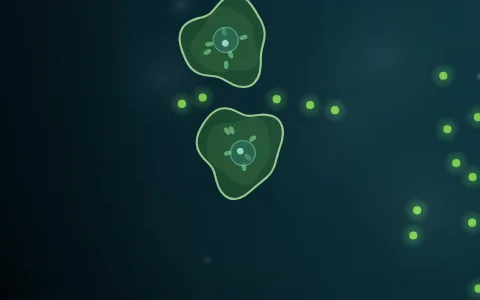 <b>amoeba</b> <code>asdf jkl</code></td>
<td width="33%">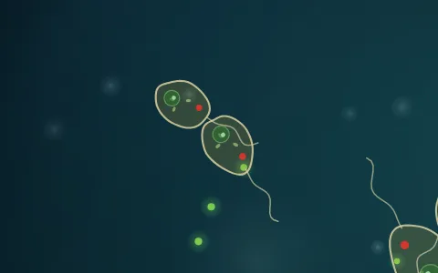 <b>flagellate</b> <code>qwert zuiop</code></td>
<td width="33%">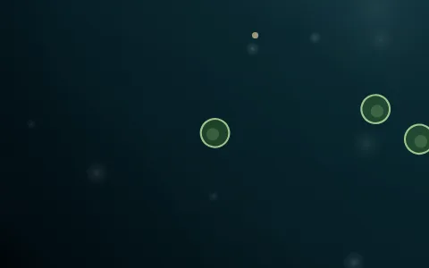 <b>coccus</b> <code>yxcv bnm</code></td>
</tr>
<tr>
<td width="33%">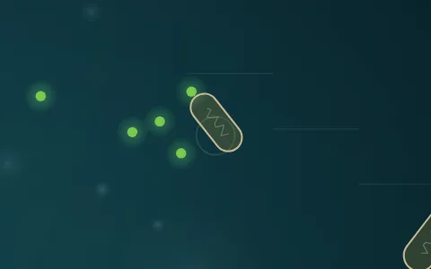 <b>bacillus</b> <code>lang_lang-ein</code></td>
<td width="33%">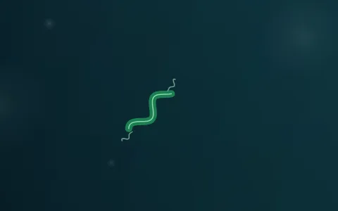 <b>spirillum</b> <code>ss@ss</code></td>
<td width="33%">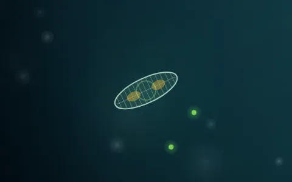 <b>diatom</b> <code>#%# 42 abc</code></td>
</tr>
<tr>
<td width="33%">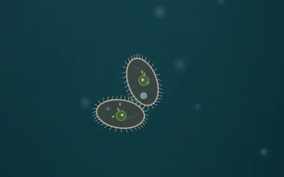 <b>ciliate</b> <code>jjjj kkkk</code></td>
<td width="33%">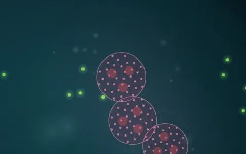 <b>volvox</b> <code>ooo (o)</code></td>
<td width="33%">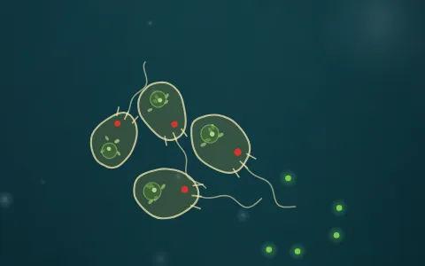 <b>predator</b> <code>HUNTER</code></td>
</tr>
<tr>
<td width="33%">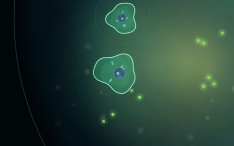 <b>photosynthetic</b> <code>asdf* 🌿☀️</code></td>
<td width="33%">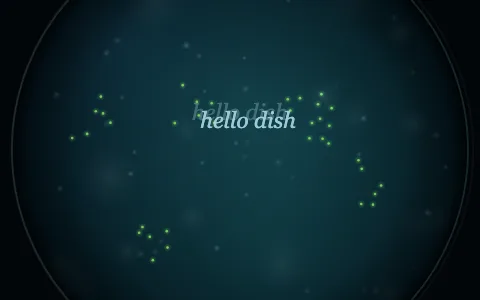 <b>words in the water</b> <code>"hello dish"</code></td>
<td width="33%">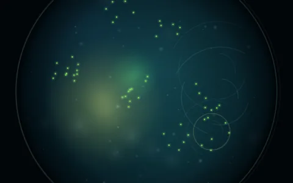 <b>feeding the dish</b> <code>🌿 ☀️ ~ 🫧</code></td>
</tr>
</table>
<!-- sheet:end -->

## Every line is a genome
How a line was typed decides what grows from it:

| In the line | Trait |
|---|---|
| keyboard row the paw stayed on | body: home row → amoeba, top row → flagellate, bottom row → coccus |
| `-` `_` `\|`, long words | rod bacterium (bacillus) |
| `@`, many `s` | spirillum |
| `#` `%`, digits | diatom (glass shell, armoured) |
| held keys `jjjj`, `=` | ciliate |
| `(` `)`, many `o` | volvox (rolling colony) |
| where on the keyboard | colour |
| vowels, word length | size |
| CAPS | predator (lots) or omnivore (some) |
| `*`, 🌿 ☀️ | photosynthetic, glows |
| `!` | toxic: whoever eats it gets sick |
| `&` 💞 | symbiotic: shares food with other symbionts |
| `...` 🍄 | leaves spores when it dies |
| `?` | mutates more when dividing |
| `+` | divides sooner |
| spaces | calmer, slower |

Every species gets a binomial name made from its own keysmash (*Asdifella jkulula*,
*Hunterophyta grana*) and is introduced in the dish when it first appears.

## Every line is also a feeder
The same line is read slowly, one token per beat (0.75 s), all lines in parallel:
words release cells of that species, numbers drop algae, `.` crumbs, `*` light,
`~` `@` a swirling current, `-` `/` a straight current, `!` a nutrient burst,
`#` sediment; emoji: 🌿 a garden that keeps growing, ☀️ light, 💧 current, 🫧
nutrients, 🍄 spores, 🦠 more cells, ❄️ cold, 🔥 warmth, ☠️ toxin, 🍬 sugar, 💞 a call
to the symbionts. Sums (`3*7=`) and `"quotes"` are written into the water.
Tap the dish to drop food.

## Life in the dish
Cells sense food, prey and threats. Rod bacteria run and tumble (keep running while
food gets closer — real chemotaxis), flagellates dart, amoebae crawl, cocci jiggle and
cluster, volvox rolls. Grazers eat algae, photosynthetic cells feed on light,
predators engulf smaller cells of other species (toxic prey makes them sick), symbionts
even out their energy when they touch. Cells divide with small mutations, age and
die; their debris feeds the next generation and spores hatch later. Division is drawn
as it happens: cells with a nucleus go through mitosis (the envelope dissolves,
chromosomes line up on the spindle and are pulled apart, a cleavage furrow pinches the
membrane, two nuclei form), bacteria split by binary fission (the rod doubles, the DNA
separates, a wall grows in from the middle), ciliates split front to back. Dying cells
swell, grey, their membrane breaks up and their contents drift away. Field notes
record the firsts: first division, first engulfing, extinctions.

## Balance
The code only inoculates (up to 4 cells per species); growth after that is up to the
culture. Above a comfortable 34 cells the dish pushes back: metabolism rises, cells
age faster and need more energy to divide. All food rots. Cells are soft bodies that
overlap only a little (colliders are 15 % smaller than the drawn bodies); swimmers turn first and then swim along their body axis. Over five
minutes the demos settle at 20–45 cells with births about equal to deaths.

## Sound
Every culture has its own music, picked from the hash of its text: one of five moods
(Lydian, Dorian, Aeolian, open suspended, Hirajoshi), each with its own four-chord
progression and pad sound, in any of 12 keys, at 60–84 BPM, straight or in triplets,
with 2, 4 or 8 bars per chord. Every body type plays its own instrument (amoeba felt
piano, rod marimba, coccus pluck, spirillum FM glass, diatom bell, ciliate vibraphone,
flagellate kalimba, volvox breath; predators an octave lower), so a culture's species
are its orchestra. Within a run the starting chord varies, a soft bass marks each
chord, the key may move by a fourth after each cycle, the pad brightens as the dish
fills, and every fifth generation plays a little motif. Engulfing is a gloop, a new
cell a water drop. Processes are sounded as they happen: a division swells softly as
the cell rounds up, stretches with a breathy glide at the furrow, and splits with a
bubble pop and one note per daughter, each on its side; a dying cell gives a low wooden
tone, then a fizz sinking for two seconds with a few faint crackles while the membrane
dissolves. Cells bumping into each other tap a soft felt mallet (the same species hums
a fifth), a cell that notices a predator and turns away rises quietly. Frequent things
are thinned out (a bump at most every 1.1 s), at most three divisions or dissolves sound
at once. Typing in the editor drips water.

